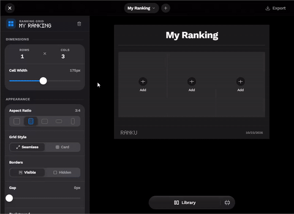

# Ranku - modern anime ranking app

Ranku is a local-first board for ranking anime supporting three layouts (grid, ordered list and a tier list) and a shared library of images for storing posters across projects. It's built for those who want an easy, stress-free alternative to building 3x3 grids or creating seasonal anime listings without having to reach for an image editor.

Everything is stored in your browser.

[Website](https://tryranku.vercel.app) | [Contributing](#contributions)

## Capabilities



- Grid, list and tier-list boards
- A centralized image library for collections and poster search
- Exports / Direct image copying with image compression
- A blend of iOS-inspired design with some 8-bit aesthetics (I don't own an iOS device and so this is mostly guided by Medium articles and very loosely on Apple's HIG, therefore expect some roughness around the edges)
- Mobile-first, and I mean it

## Development

```bash
pnpm install
pnpm dev      # http://localhost:5173
pnpm build
```

The app uses the AniList and Jikan/myAnimeList API for poster search, and a small Flask proxy in `backend/` to get around Jikan CORS and other site URLs when embedding hosted artwork into a canvas export. Search will still work without it, but remote images will appear blank on canvas export.

```pwsh
cd backend
python -m venv venv && source venv/Scripts/activate   # or venv/bin/activate
pip install -r requirements.txt
python app.py                                          # http://localhost:5000
```

Copy `.env.example` to `.env` and set `VITE_IMAGE_PROXY_URL=http://localhost:5000/proxy/image`.

## Known Issues

As of October 2026, the Jikan API currently doesn't work and is [likely going to be discontinued altogether](https://github.com/jikan-me/jikan-rest/issues/610), so for now the AniList API will be the only available option before a switch to [Tenrai](https://tenrai.org) is implemented as AniList itself is also [currently facing performance issues](https://anilist.co/forum/thread/92613).

## Requirements

React 19, TypeScript, Zustand, TailwindCSS 4, Motion, dnd-kit, and html-to-image.

## Contributions

If you have a bug you want to fix or a feature you want to add, feel free to create a PR. All contributions are welcome.

## License

MIT

Built with &#x2764; and maintained by [Whitestar14](https://github.com/Whitestar14).
